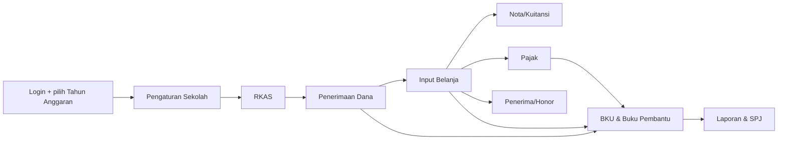

# Rencana Aplikasi LPJ BOS

Aplikasi web berbasis Go + SQLite yang dijalankan di container Docker untuk membantu bendahara menyusun laporan BOSP Reguler, mulai dari input belanja, BKU, penerima, nota/kuitansi, hingga SPJ lengkap.

## 0. Ruang Lingkup

| Aspek | Keputusan |
|---|---|
| Platform | Web app Go (satu binary), dijalankan lokal via Docker (akses `http://localhost:8080`) |
| Jenjang | Campuran (SD/MI, SMP/MTs, SMA/SMK/MA) — dapat diatur per profil sekolah |
| Jenis dana | BOSP Reguler |
| Pengguna | Satu sekolah, satu pengguna |
| Output | BKU, Buku Pembantu Kas Tunai, Buku Pembantu Bank, Buku Pembantu Pajak, Kuitansi/Nota, Daftar Penerima, Rekap per Komponen/SNP, Realisasi vs RKAS, SPJ lengkap (PDF), Export Excel |

## 1. Tech Stack

| Bagian | Pilihan | Alasan |
|---|---|---|
| Bahasa | **Go 1.26** (stdlib `net/http`) | Satu binary tanpa CGO, cepat, mudah di-deploy |
| Template | `html/template` (tertanam via `embed`) | Escape otomatis, tanpa file terpisah saat deploy |
| Database | **SQLite** via `modernc.org/sqlite` (pure Go) | Satu file, tanpa server DB, mudah di-backup |
| UI | HTML + CSS/JS sendiri (aset lokal tertanam, tanpa CDN) | Ringan, bisa dipakai offline |
| Interaksi | JavaScript vanilla (`assets/js/app.js`) | Item belanja dinamis, hitung pajak di form |
| PDF | `go-pdf/fpdf` + font Liberation | Kuitansi, bukti terima, BKU, SPJ |
| Excel | `xuri/excelize` | Export/import `.xlsx` dengan format |
| Terbilang | Helper Go sendiri | Nominal dalam huruf untuk kuitansi |
| Container | Docker multi-stage (`golang` → `alpine`) + Compose | Sekali `docker compose up`, langsung jalan |

### 1.1 Arsitektur

- **Entry point**: `src/cmd/lpjbos/main.go` → `app.Run()`; router `http.ServeMux` di `server.go`.
- **Pola**: `c_*.go` (handler halaman), `svc_*.go` (logika & validasi), `templates/` (tampilan), `mcp*.go` (server MCP).
- **Keamanan dasar**: prepared statement, escape output otomatis, token CSRF di setiap form POST, login dengan password hash (bcrypt).
- **Migrasi**: file SQL bernomor di `migrations/` (tertanam) dijalankan otomatis saat start (tabel `migrations`).
- **Transaksi DB**: simpan belanja + item + pajak dalam satu transaksi; request tulis (POST/MCP) diserialkan dengan kunci level aplikasi agar transaksi tidak saling bercampur.
- SQLite: `PRAGMA foreign_keys = ON` dan `journal_mode = WAL`.

### 1.2 Container

- `Dockerfile`: build di `golang:1.26-alpine`, hasil binary disalin ke `alpine` (port 80, `DATA_DIR=/var/www/data`).
- `docker-compose.yml`: produksi (Dokploy), data di volume `lpjbos-data`.
- `docker-compose.override.yml`: dev lokal, port `8080` dan mount `./data`.

> ⚠️ File database dan lampiran disimpan di volume `./data`, sehingga data tetap aman meski container dihapus. **Backup = salin file `lpjbos.sqlite`** (tersedia juga tombol download/restore di aplikasi).

## 2. Alur & Modul



### 2.1 Pengaturan
- Profil sekolah: nama, NPSN, jenjang, alamat, kecamatan, kabupaten, rekening bank, logo.
- Pejabat: Kepala Sekolah & Bendahara (nama, NIP) — dengan riwayat per periode.
- Tahun anggaran: lihat 2.1a.

#### 2.1a Tahun Anggaran (sesi)
Aplikasi dipakai terus setiap tahun, jadi tahun anggaran adalah **sesi kerja**, bukan sekadar isian profil.
- **Login:** pilih tahun anggaran dulu (tahun *default* sudah terpilih), lalu username & password. Tahun disimpan di sesi.
- **Pengaturan › Tahun anggaran:** tambah tahun baru (mis. 2027), tandai satu tahun sebagai **default**, buka (pindah ke) tahun lain, dan hapus tahun yang masih kosong. Tahun default dan tahun yang sudah berisi data tidak bisa dihapus.
- **Ganti tahun tanpa logout:** dari sidebar ("Tahun anggaran 2026 · Ganti") atau pil tahun di bagian atas (HP).
- **Data terpisah per tahun:** rencana belanja, penerimaan, belanja/BKU, mutasi, dan dashboard hanya menampilkan tahun yang sedang dibuka. Data master (sekolah, pejabat, penerima, toko, rekening) berlaku untuk semua tahun.
- **Validasi:** tanggal transaksi baru wajib di dalam tahun yang dibuka, dan belanja hanya bisa memakai rencana dari tahun itu.
- **Saldo per tahun:** saldo kas dihitung mulai 1 Januari tahun berjalan. Sisa dana tahun lalu dicatat sebagai penerimaan "Sisa tahun lalu (SiLPA)" di awal tahun baru.

#### Upload Kop Surat & Identitas (gambar siap pakai)

| Item | Format | Dipakai di |
|---|---|---|
| **Kop surat** (gambar jadi, lebar penuh) | PNG/JPG, disarankan ±2000×300 px | Header semua dokumen PDF: kuitansi, bukti terima, BKU, laporan, SPJ |
| **Tanda tangan Kepala Sekolah** (scan) | PNG transparan | Blok tanda tangan "Mengetahui, Kepala Sekolah" |
| **Tanda tangan Bendahara** (scan) | PNG transparan | Blok tanda tangan "Bendahara" |
| **Stempel sekolah** (opsional) | PNG transparan | Ditumpuk di atas tanda tangan Kepala Sekolah |

- Kop surat: jika gambar sudah di-upload, **gambar kop dipakai langsung**. Jika belum ada, kop dibuat otomatis dari teks (logo + nama + alamat sekolah).
- Tanda tangan & stempel dapat diaktifkan atau dimatikan **per dokumen saat cetak**, dengan pilihan *Cetak dengan TTD digital* atau *Kosong untuk TTD basah*.
- Tanda tangan melekat ke data Pejabat per periode. Jika kepala sekolah atau bendahara berganti, dokumen lama tetap memakai tanda tangan pejabat yang menjabat pada tanggal transaksi.
- Ada preview langsung setelah upload. Gambar disimpan di `data/uploads/`, divalidasi tipenya (PNG/JPG saja) dan ukurannya (maks. 2 MB), lalu otomatis diperkecil bila terlalu besar.
- File upload ikut masuk ke backup.

### 2.2 Data Master
- Toko/penyedia: nama, NPWP, alamat, status PKP.
- Penerima (detail di bawah).
- Komponen BOSP (12 komponen) & kode rekening belanja.
- Tarif pajak yang bisa diatur (PPN, PPh 21, 22, 23, 4(2), pajak daerah).

#### Database Penerima (Guru, Tendik, Pihak Luar)
Daftar orang yang bisa menerima honor/transport, sehingga cukup dipilih saat input transaksi.

| Field | Keterangan |
|---|---|
| Nama lengkap (+ gelar) | Wajib |
| NIP / NIK | NIP untuk PNS/PPPK, NIK untuk non-ASN/pihak luar |
| NPWP | Opsional. Untuk penerima PNS, tarif final honor tidak berubah; untuk rekanan (toko), NPWP menentukan tarif PPh 22 dan PPh 23 |
| Kategori | PNS, PPPK, GTT/Honorer, PTT/Tendik, Pihak Luar (narasumber, pelatih, dll) |
| Jenis penerima (PPh 21) | Pegawai tetap/PPPK, pegawai tidak tetap, bukan pegawai, peserta kegiatan. Menentukan rezim pemotongan menurut PMK 168/2023 |
| Kategori PTKP | A/B/C, dipakai untuk tarif efektif bulanan pegawai tetap |
| Golongan | Mis. III/a, IV/b. Dipakai untuk tarif final PPh 21 PNS (gol. I–II 0%, III 5%, IV 15%). PPPK tidak memakai tarif final ini |
| Jabatan | Mis. Guru Kelas 4, Operator, Penjaga Sekolah, Pembina Pramuka |
| No. HP, alamat | Opsional |
| Bank, no. rekening, atas nama | Opsional, untuk pembayaran transfer |
| Status aktif | Penerima nonaktif tidak muncul di pilihan, tetapi riwayatnya tetap ada |

**Fitur:**
- Tambah, ubah, nonaktifkan (tidak dihapus permanen jika sudah punya transaksi), dan cari/filter per kategori.
- **Import dari Excel** (template disediakan) dan **export ke Excel**.
- Tambah cepat dari form honor/transport: nama baru yang diketik bisa langsung disimpan ke database penerima.
- **Riwayat penerimaan per orang**: daftar honor/transport yang pernah diterima, total bruto, PPh 21, dan netto per bulan/tahun. Berguna untuk rekap PPh 21 dan bukti potong.
- **Tarif default per penerima** (opsional), misalnya honor GTT Rp500.000/bulan, otomatis terisi saat dipilih.
- Data nama/jabatan/golongan disalin (snapshot) ke setiap transaksi, sehingga perubahan data penerima tidak mengubah bukti lama.

### 2.3 Rencana Belanja (Anggaran / RKAS)
Rencana menjadi **paket belanja berulang** yang dipilih saat mengisi BKU. Satu rencana dapat memuat banyak barang atau banyak penerima honor/transport.

- Field paket: tahun, komponen, kegiatan, kode rekening, nama paket, frekuensi/periode, dan jadwal.
- **Barang/jasa:** satu toko/penyedia bawaan dan beberapa baris barang, masing-masing berisi nama, jumlah per periode, satuan, dan harga perkiraan.
- **Honor/transport:** beberapa penerima dalam satu paket, masing-masing dengan volume, satuan, dan tarif per periode. Penerima dipilih dari master dan dapat ditambah sebanyak yang diperlukan.
- Pagu total = jumlah nilai seluruh barang/penerima dalam satu periode × frekuensi yang direncanakan.
- Contoh: paket **Belanja ATK** berisi buku 2, tinta 1, dan kertas F4 3 per bulan; frekuensi 6 bulan. Toko/penyedia ditentukan pada paket.
- Sumber data: **input manual** di aplikasi **atau import Excel ARKAS** (keduanya tersedia).
- Setiap rencana belanja menampilkan: **Pagu – Terpakai = Sisa**.

### 2.4 Penerimaan Dana
- Catat target pendapatan per tahun, tahap/sumber, uraian, perkiraan bulan, dan nominal.
- Tahap/sumber yang tersedia: BOSP Tahap 1, Tahap 2, SiLPA, dan lainnya.
- Saat mencatat penerimaan aktual, pasangkan ke rencana pendapatan yang sesuai. Satu rencana dapat menerima beberapa pencatatan aktual.
- Halaman Rencana Pendapatan menampilkan target, total aktual yang terpasang, selisih, dan penerimaan aktual yang belum dipasangkan.
- Penerimaan tanpa rencana tetap sah dan tetap menambah saldo BKU; sistem hanya menandainya sebagai belum dipasangkan.

### 2.5 Input Transaksi Belanja ke BKU (inti)
Saat membuat transaksi BKU, pengguna **memilih rencana belanja** (mis. *Belanja ATK*), lalu sisa anggaran otomatis berkurang.

**Jenis transaksi belanja:**

| Jenis | Isian rincian | Bukti yang dihasilkan |
|---|---|---|
| **Barang/Jasa** (ATK, bahan, pemeliharaan, dll) | Toko + item (nama barang, qty, satuan, harga) | Kuitansi, nota |
| **Honor** | Daftar penerima: nama, jabatan, volume (mis. jam/OK/bulan) × tarif = jumlah honor, PPh 21 | Kuitansi + Daftar Bukti Terima Honor |
| **Transport** | Daftar penerima: nama, jabatan, volume (mis. hari/kali) × tarif = jumlah transport | Kuitansi + Daftar Bukti Terima Transport |

Jenis transaksi bisa ditentukan otomatis dari kode rekening rencana belanja (mis. rekening honor/perjalanan dinas), tetapi tetap bisa diubah manual.

**Alur:**
1. Cari dan pilih paket rencana berdasarkan uraian/komponen. Yang tampil: jenis, periode tersisa, dan **sisa anggaran**.
2. Tentukan berapa periode/bulan yang benar-benar dibeli atau dibayar. Sistem mengisi rincian paket secara otomatis: jumlah barang dikalikan periode, atau semua penerima beserta volume honornya dikalikan periode. Toko paket terisi otomatis.
3. Isi tanggal, nomor nota/bukti, dan metode bayar. Rincian barang, penerima, tarif, toko, dan harga aktual dapat disesuaikan untuk transaksi nyata.
4. **Satu nota pembayaran = satu transaksi BKU.** Jika satu nota mencakup tiga bulan, catat satu transaksi dengan tiga periode; jika ada nota berbeda tiap bulan, catat tiap nota sebagai transaksi tersendiri. Satu pembayaran honor dapat berisi beberapa penerima.
5. Sistem menghitung total dan pajak otomatis. **Validasi** memastikan jumlah periode tidak melebihi sisa periode paket dan nilai aktual tidak melebihi sisa pagu.
6. Saat disimpan, rincian aktual disalin ke transaksi (snapshot); revisi paket setelahnya tidak mengubah transaksi lama. Sisa periode dan sisa rupiah sama-sama berkurang sesuai pemakaian.

**Contoh (pagu ATK Rp1.200.000, model sisa = satu total, bebas kapan saja):**

| Tgl | Transaksi BKU | Nilai | Terpakai | Sisa ATK |
|---|---|---:|---:|---:|
| — | Pagu awal | | 0 | 1.200.000 |
| 10 Jan | Beli kertas & pulpen | 200.000 | 200.000 | 1.000.000 |
| 12 Feb | Beli tinta printer | 350.000 | 550.000 | 650.000 |
| 05 Mar | Beli map & spidol | 150.000 | 700.000 | 500.000 |
| 20 Apr | Beli ATK Rp600.000 | ❌ ditolak | 700.000 | 500.000 |

**Aturan:**
- **Sisa rupiah = Pagu − Σ transaksi BKU**, dan sisa periode = frekuensi rencana − Σ periode pada BKU. Keduanya dihitung dari transaksi, bukan disimpan manual.
- Jadwal rencana menjadi panduan; periode yang akan dibeli/dibayar dipilih saat input BKU.
- Mengedit atau menghapus transaksi otomatis mengembalikan atau menyesuaikan sisa.
- Validasi pagu dilakukan di server (Go) dan juga ditampilkan langsung di form (JavaScript).
- Untuk menambah pagu, ubah rencana belanja (revisi anggaran), bukan dengan memaksa transaksi.

### 2.6 Mutasi Kas
- Tarik tunai (bank → tunai), setor tunai (tunai → bank).
- Biaya administrasi bank, bunga/jasa giro.
- Setor pajak: kode billing, NTPN, tanggal setor.

### 2.7 Honor & Transport (Penerima)
- Setiap transaksi honor/transport berisi **daftar penerima**: nama, NIP/NIK, jabatan/golongan, volume, satuan, tarif, jumlah bruto, PPh 21, jumlah diterima (netto).
- **PPh 21** dihitung otomatis untuk honor sesuai rezim penerima (PMK 168/2023): PNS memakai tarif final golongan (I–II 0%, III 5%, IV 15%), bukan pegawai 50% × tarif Pasal 17 (efektif 2,5% pada lapisan pertama), pegawai tidak tetap memakai tarif efektif harian (0% s.d. Rp450.000, 0,5% s.d. Rp2.500.000 sehari), peserta kegiatan memakai bruto utuh. PPPK tidak memakai tarif final PNS. Semua masuk Buku Pembantu Pajak. Transport secara default tidak dipotong pajak, tetapi tetap bisa diatur.
- Master Penerima dipakai ulang agar tidak perlu mengetik nama berulang kali.
- Tersedia tombol **Salin dari transaksi sebelumnya**, misalnya untuk honor bulanan dengan penerima yang sama.

**Daftar Bukti Terima (PDF)** — kop sekolah, judul kegiatan, bulan, tabel:

| No | Nama | Jabatan | Volume | Tarif | Jumlah | PPh 21 | Diterima | Tanda Tangan |
|---|---|---|---|---:|---:|---:|---:|---|

Di bawah tabel terdapat total, terbilang, serta tanda tangan Kepala Sekolah dan Bendahara. Kolom tanda tangan dibuat zig-zag (nomor ganjil di kiri, genap di kanan).

### 2.8 Nota / Kuitansi
- Kuitansi berisi: nomor bukti, sudah terima dari (Bendahara BOSP sekolah), uang sejumlah (angka + **terbilang**), untuk pembayaran (uraian), tanggal, tanda tangan penerima, Bendahara, dan Kepala Sekolah. Penanda meterai muncul untuk nilai > Rp5.000.000.
  - Barang/Jasa: penerima = nama toko.
  - Honor/Transport: kuitansi global atas total, dengan lampiran Daftar Bukti Terima.
- Nota pesanan dan BAST (untuk barang).
- Penomoran bukti otomatis (format bisa diatur).
- Lampiran foto/scan nota asli.
- PDF kuitansi per transaksi dan PDF daftar bukti terima honor/transport sudah tersedia dari BKU; kuitansi honor/transport merujuk ke daftar penerima terlampir.
- Nota, BAST, dan dokumen lain dapat diunggah, dilihat, dan dihapus pada detail transaksi belanja. Format unggahan: PDF/JPG/PNG, maksimal 2 MB per berkas.
- Penanda meterai otomatis, pembuatan BAST, dan cetak massal masih perlu dikerjakan. Format PDF dapat disesuaikan setelah ada contoh resmi dari dinas.

### 2.9 Aksi Cetak di Halaman BKU
Setiap baris transaksi belanja di BKU memiliki tombol aksi:

| Tombol | Muncul untuk | Hasil |
|---|---|---|
| 🧾 **Cetak Kuitansi** | Semua belanja | PDF kuitansi (buka/print atau download) |
| 📄 **Download Bukti Terima** | Honor & Transport | PDF Daftar Bukti Terima beserta tanda tangan penerima |
| 📎 **Lampiran** | Jika ada upload | Lihat/download nota asli |
| ✏️ Edit / 🗑️ Hapus | Bulan belum ditutup | Ubah transaksi, sisa anggaran ikut menyesuaikan |

Tersedia juga **cetak massal**: pilih beberapa baris atau satu bulan, lalu klik *Cetak semua kuitansi* atau *Cetak semua bukti terima* untuk menghasilkan satu PDF gabungan.

- Nomor bukti BKU memakai satu urutan untuk penerimaan, mutasi, dan belanja dalam satu tahun anggaran; urutan mengikuti tanggal transaksi dari paling awal.
- Tanggal dapat diubah langsung dari kolom Tanggal di BKU. Setelah tanggal disimpan, urutan transaksi, nomor bukti, dan saldo berjalan dihitung ulang otomatis.

### 2.10 Ketentuan Pajak

Aplikasi mengikuti aturan berikut; angka tarif dapat disesuaikan di menu **Tarif pajak**, tetapi logika pemungutannya tetap.

| Pajak | Ketentuan | Dasar hukum |
|---|---|---|
| PPN | Dipungut bila rekanan PKP dan nilai **di luar PPN** lebih dari Rp2.000.000. Nilai nota dianggap sudah termasuk PPN, jadi PPN = 11/111 × pembayaran. Tidak dipungut untuk transaksi lewat SIPLah | PMK 59/2022 Pasal 18; PMK 131/2024 jo. PMK 11/2025 |
| PPh 22 | 1,5% dari nilai di luar PPN, menjadi 3% bila rekanan tanpa NPWP. **Tidak dipungut** untuk pembelian barang dengan dana BOS/BOP, untuk pembayaran ≤ Rp2 juta, dan untuk transaksi SIPLah | PMK 59/2022 Pasal 12; PMK 81/2024 Pasal 219 |
| PPh 23 | 2% dari bruto untuk sewa harta dan imbalan jasa, menjadi 4% bila rekanan tanpa NPWP. Tidak ada batas minimal | PMK 59/2022 Lampiran VI |
| PPh 21 PNS | Final: golongan I–II 0%, III 5%, IV 15%, tidak termasuk biaya perjalanan dinas | PP 80/2010 Pasal 4 ayat (2) |
| PPh 21 bukan pegawai | 50% × bruto × tarif Pasal 17, efektif 2,5% pada lapisan pertama | PMK 168/2023 Pasal 12 ayat (3) |
| PPh 21 pegawai tidak tetap | Tarif efektif harian: 0% s.d. Rp450.000, 0,5% s.d. Rp2.500.000 sehari; di atas itu 50% × Pasal 17 | PMK 168/2023 Pasal 12 ayat (2); PP 58/2023 Lampiran D |
| PPh 21 peserta kegiatan | Tarif Pasal 17 atas bruto utuh | PMK 168/2023 Pasal 12 ayat (6) |
| Bea meterai | Kuitansi/bukti penerimaan uang di atas Rp5.000.000 perlu meterai Rp10.000 | UU 10/2020 Pasal 3 dan 5 |

Catatan penting:
- PPh 4 ayat (2) — sewa tanah/bangunan 10% dan jasa konstruksi 1,75%–6% — **belum** dihitung otomatis. Bila ada rehab/pemeliharaan lewat penyedia jasa konstruksi, potong manual dan catat di BKU.
- Aturan lama PPh 21 flat 5%/6% untuk non-ASN sudah dihapus karena tidak punya dasar hukum.
- Pajak daerah (mis. PBJT makanan/minuman) dipungut oleh restoran sebagai wajib pajak, bukan oleh bendahara.

### 2.11 Laporan

- Buku Kas Umum (BKU).
- Buku Pembantu Kas Tunai, Buku Pembantu Bank, Buku Pembantu Pajak.
- Rekap per komponen/SNP.
- Realisasi vs RKAS.
- Register Penutupan Kas & Berita Acara Pemeriksaan Kas.
- SPJ lengkap per bulan/tahap (satu PDF).
- Export Excel untuk semua laporan.

### 2.12 Utilitas
- Backup: download file `.sqlite` (+ zip lampiran & uploads kop/TTD); restore: upload file backup.
- Tutup buku bulanan (mengunci transaksi bulan yang sudah ditutup).

### 2.13 Undangan & Notulen Rapat

Dokumen pendukung SPJ untuk kegiatan rapat (mamin rapat, honor/transport peserta). Setiap undangan/notulen **wajib terkait satu transaksi belanja di BKU**, tidak ada rapat yang berdiri sendiri.

**Alur input**
1. Menu *Keuangan › Notulen rapat* → **Buat baru**.
2. Pilih **komponen** terlebih dahulu, lalu pilih **transaksi belanja BKU** pada komponen itu (tahun aktif, belum punya notulen). Bisa juga langsung dari tombol **📝 Notulen** di baris BKU, sehingga komponen dan belanja sudah terpilih.
3. Form terisi otomatis dari belanja: tanggal rapat = tanggal belanja, agenda = uraian belanja, tempat = nama sekolah.
4. Isi undangan: tanggal surat, sifat, lampiran, perihal, kepada (tujuan), hari/tanggal, jam, tempat, agenda.
5. Isi notulen: pimpinan rapat, notulis, jumlah peserta, pembukaan, pembahasan, keputusan, dan tindak lanjut.

**Aturan**
- Satu belanja maksimal satu rapat (`UNIQUE(belanja_id)`). Bila belanja dihapus, rapat ikut terhapus (CASCADE).
- Tanggal surat ≤ tanggal rapat, dan keduanya harus berada di tahun anggaran aktif.
- Rapat boleh hanya berisi undangan; notulen bisa dilengkapi belakangan. PDF notulen hanya tersedia bila bagian pembahasan sudah diisi.

**Nomor undangan otomatis**
- Format: `{urut:03}/UND/{NPSN}/{bulan romawi}/{tahun}`, contoh `007/UND/20512345/XI/2026`.
- Nomor urut per tahun anggaran berdasarkan tanggal surat. Nomor dibuat saat simpan dan tetap bisa diedit manual (nilai unik per tahun).

**Dokumen PDF** (memakai `PdfKit`, kop surat, TTD & stempel kepala)
- **Undangan**: kop, nomor/sifat/lampiran/perihal, Yth. tujuan, isi (hari, tanggal, jam, tempat, agenda), lalu TTD Kepala Sekolah.
- **Notulen**: judul, identitas rapat (hari/tanggal, jam, tempat, pimpinan, notulis, peserta, agenda), bagian pembukaan/pembahasan/keputusan/tindak lanjut, lalu TTD notulis (kiri) dan pimpinan/kepala (kanan).
- Rute: `/dokumen/rapat/{id}/undangan.pdf`, `/dokumen/rapat/{id}/notulen.pdf`.

**Integrasi**
- **BKU**: tombol 📝 di baris belanja: *Buat notulen* bila belum ada, *Lihat/Cetak* bila sudah ada.
- **SPJ**: bila periode memuat belanja yang punya rapat, PDF SPJ ditambah bagian "Undangan & Notulen" setelah rincian bukti belanja, urut sesuai BKU.
- **Cetak massal BKU**: `/dokumen/bku/rapat.pdf?periode=…`.
- **MCP**: `rapat_list`, `rapat_detail`, `rapat_simpan`, `rapat_hapus`.

**Tahapan**
1. Migrasi `012_rapat.sql`, `svc_rapat.go` (validasi, nomor otomatis), CRUD `c_rapat.go` + template `rapat/index|form`.
2. PDF undangan & notulen (`svc_pdf_rapat.go`).
3. Tombol di BKU, gabung ke SPJ, cetak massal.
4. Tool MCP + uji (`rapat_test.go`).

## 3. Model Data

```text
Sekolah(id, nama, npsn, jenjang, alamat, rekening, logoPath, kopPath, stempelPath)
Pejabat(id, peran[kepsek|bendahara], nama, nip, ttdPath, mulai, selesai)
Komponen(kode, nama)
KodeRekening(kode, uraian)
TarifPajak(jenis, tarif, keterangan)
TahunAnggaran(tahun, isDefault, keterangan)   # satu tahun default; tahun aktif disimpan di sesi login

RencanaBelanja(id, tahun, komponenKode, kegiatan, rekeningKode, uraian,
               jenis, frekuensiBulan, tokoDefaultId, pagu, jadwalBulan, sumber[manual|import])
  ├ ItemRencana(id, rencanaId, nama, qtyPerPeriode, satuan, hargaPerkiraan)       # barang/jasa
  └ PenerimaRencana(id, rencanaId, penerimaId, volumePerPeriode, satuan, tarif)   # honor/transport
  # sisa rupiah = pagu - SUM(Belanja.total); sisa periode = frekuensiBulan - SUM(Belanja.jumlahPeriode)
RencanaPendapatan(id, tahun, tahap, uraian, targetBulan, targetJumlah)
  # realisasi = SUM(Penerimaan.jumlah) untuk penerimaan yang dipasangkan ke rencana ini
Penerimaan(id, tgl, sumber, tahap, rencanaPendapatanId?, nominal, keterangan)

Toko(id, nama, npwp, alamat, pkp)
Penerima(id, nama, nip, nik, npwp, kategori[pns|pppk|gtt|ptt|luar], golongan,
         jenisPenerima[tetap|tidak_tetap|bukan_pegawai|peserta], ptkp[A|B|C],
         jabatan, noHp, alamat, bank, noRekening, atasNama, tarifDefault, aktif)

Belanja(id, noBukti, tgl, rencanaId, jumlahPeriode,
        jenis[barang|honor|transport], tokoId (null utk honor/transport),
        uraian, metode[tunai|bank], total, danaBos, viaSiplah)
  ├ ItemBelanja(id, belanjaId, nama, qty, satuan, harga)            # jenis = barang
  ├ PenerimaBelanja(id, belanjaId, penerimaId, nama, nipNik, jabatan,  # jenis = honor/transport
  │                 golongan, npwp, volume, satuan, tarif,            # data penerima di-snapshot
  │                 bruto, pph21, netto)
  ├ Pajak(id, belanjaId, jenis, dpp, tarif, nilai, tglSetor, ntpn, kodeBilling)
  └ Lampiran(id, belanjaId, namaFile, path)   # file di data/lampiran/

Rapat(id, tahun, belanjaId UNIQUE, noUndangan, tglSurat, sifat, lampiran, perihal, kepada,
      tgl, jamMulai, jamSelesai, tempat, agenda,
      pimpinan, notulis, jumlahPeserta, pembukaan, pembahasan, keputusan, tindakLanjut)

MutasiKas(id, tgl, jenis[tarik|setor|admin_bank|bunga], nominal, keterangan)
TutupBuku(bulan, tahun, saldoTunai, saldoBank, terkunci)
```

**Prinsip:** BKU dan buku pembantu **tidak disimpan**, melainkan dihitung (derived) dari Penerimaan, Belanja, Pajak, dan MutasiKas agar angka selalu konsisten.

## 4. Struktur Folder

```text
LPJ BOS/
  Dockerfile
  docker-compose.yml
  docker-compose.override.yml
  data/                     # lpjbos.sqlite + lampiran/ + uploads/ (kop, TTD, stempel; tidak di-commit)
  src/
    go.mod
    cmd/lpjbos/main.go      # entry point
    internal/app/
      server.go             # router, middleware, sesi, CSRF
      db.go                 # wrapper SQLite + transaksi + runner migrasi
      helpers.go            # rupiah, terbilang, tanggal Indonesia, saldo kas, nomor bukti
      c_*.go                # handler: auth, sekolah, master, rencana, penerimaan, belanja/BKU, mutasi, dokumen, laporan, backup
      svc_*.go              # service: belanja, penerimaan, mutasi, rencana, lampiran, laporan, PDF
      laporan_excel.go, master_excel.go
      mcp.go, mcp_*.go      # server MCP (akses AI)
      migrations/           # 001_init.sql, 002_seed.sql, ...
      templates/            # layouts/, auth/, bku/, belanja/, laporan/, ...
      assets/               # css/, js/, fonts/
```

## 5. Tahapan Pengerjaan

| Fase | Isi | Hasil |
|---|---|---|
| **1. Fondasi** | Dockerfile + compose, struktur Go, router, koneksi SQLite + migrasi, login, layout, profil sekolah, upload kop surat/TTD/stempel, data master (toko, database penerima + import/export Excel, komponen, rekening, pajak), backup/restore | Container jalan, kerangka aplikasi siap |
| **2. Transaksi inti** | Rencana belanja (input manual), penerimaan, transaksi BKU dengan pilih rencana belanja (jenis barang/jasa, honor, transport + daftar penerima), validasi & pengurangan sisa pagu, mutasi kas, pajak otomatis | Data bisa diinput, sisa anggaran otomatis berkurang |
| **3. Buku kas** | BKU, BP Tunai/Bank/Pajak, saldo berjalan, tutup buku | Buku kas jadi |
| **4. Dokumen bukti** | Kuitansi + terbilang, Daftar Bukti Terima honor/transport, nota, BAST, lampiran, tombol Cetak Kuitansi & Download Bukti Terima di BKU, cetak massal | Bukti siap cetak dari BKU |
| **5. RKAS & rekap** | Import Excel ARKAS ke rencana belanja, revisi anggaran, realisasi vs RKAS, rekap per komponen | Kontrol anggaran lengkap |
| **6. SPJ & ekspor** | PDF SPJ lengkap, export Excel semua laporan, BA pemeriksaan kas | Laporan siap serah |
| **7. Penyempurnaan** | Dashboard, pencarian, duplikasi transaksi, template belanja rutin, backup otomatis harian | Nyaman dipakai |

### Checklist

- [x] Fase 1 — Fondasi (selesai)
- [x] Fase 2 — Transaksi inti (selesai)
- [x] Tahun anggaran sebagai sesi: pilih di login, kelola & default di Pengaturan, data terpisah per tahun
- [x] Dokumen transaksi awal: PDF kuitansi, daftar bukti terima, serta unggah/lihat/hapus lampiran nota dan BAST
- [x] Rencana paket berulang: banyak barang atau penerima per paket, dipakai kembali di BKU sesuai jumlah periode
- [x] Rencana pendapatan: target per tahap/sumber dan pencocokan dengan penerimaan aktual
- [x] BKU: edit tanggal langsung, urutkan nomor bukti bersama berdasarkan tanggal, dan hitung ulang saldo otomatis
- [ ] Fase 3 — Buku kas
- [ ] Fase 4 — Dokumen bukti
- [ ] Fase 5 — RKAS & rekap
- [x] Fase 6 — SPJ & ekspor (setor pajak/NTPN belum ada UI)
- [ ] Fase 7 — Penyempurnaan
- [x] Server MCP untuk asisten AI (lihat di bawah)
- [ ] Undangan & notulen rapat terkait belanja BKU (lihat 2.13)

### Server MCP (akses AI)

- Endpoint `POST /mcp` (JSON-RPC 2.0, Streamable HTTP mode JSON), header `Authorization: Bearer lpbos_…`. Tidak memakai sesi/CSRF.
- Token dikelola di **Sistem → Akses AI (MCP)** (`/api`): akses *baca* atau *tulis*, disimpan sebagai hash SHA-256, ditampilkan sekali. Semua panggilan dicatat di `api_log`.
- Kode: `mcp.go` (transport, protokol, autentikasi token), `mcp_baca.go`, `mcp_tulis.go`, `mcp_laporan.go`, `mcp_pengaturan.go`.
- Tool baca: status, tahun_list, sekolah, komponen/rekening/pajak/toko/penerima_list, rencana_list/detail, penerimaan_list, rencana_pendapatan_list, bku, saldo, laporan_list, laporan.
- Tool tulis: penerimaan/mutasi/belanja/rencana `_simpan` (tanpa id = baru, dengan id = ubah) dan `_hapus`. Validasi lewat service yang sama dengan form web (`svc_*.go`); tahun diambil dari `tgl`, harus tahun yang terdaftar.

### Menjalankan aplikasi

```bash
docker compose up -d --build   # pertama kali
docker compose up -d           # selanjutnya
cd src && go run ./cmd/lpjbos  # tanpa Docker
```

## 6. Yang Perlu Disiapkan

- Contoh format laporan dari dinas setempat (BKU, kuitansi, SPJ) — format bisa berbeda per daerah.
- Daftar kode rekening yang dipakai di ARKAS.
- Tarif pajak daerah yang berlaku (mis. pajak restoran) dan ketentuan PPN terbaru.
- Konfirmasi apakah data tetap diinput ke ARKAS (bila ya, tambahkan export dengan urutan kolom yang memudahkan input ke ARKAS).
